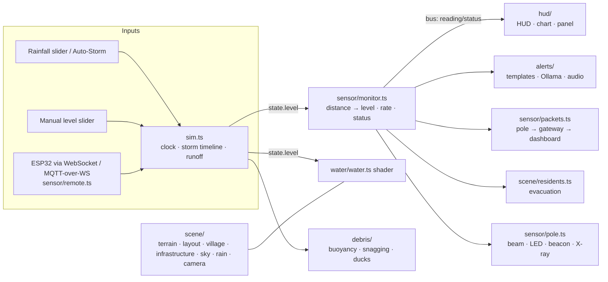

# Bantay Baha

**Bantay Baha** ("flood watch") is an interactive 3D flood-monitoring simulator of a Philippine barangay beside a creek. A solar-powered smart pole with an ESP32 and a waterproof ultrasonic sensor measures the distance to the water. That reading drives the flood you see, the HUD, multilingual advisories, sirens and evacuation.

**Live demo:** [embeddedbantaybaha.vercel.app](https://embeddedbantaybaha.vercel.app)

It comes as three pages:

| Page | What it is |
| --- | --- |
| `index.html` | The simulator: free camera over the barangay, live HUD, control panel |
| `play.html` | **One night by the creek**, a first-person story game where you are the barangay captain |
| `dashboard.html` | The operations dashboard a barangay would actually use, on a phone or laptop |

Built with **Vite + TypeScript + Three.js**. The terrain, buildings, water, textures and sound are procedural. The people are rigged, animated CC0 characters by [Quaternius](https://quaternius.com), slimmed down to about 0.5 MB each (see `public/models/CREDITS.md`), with skin and hair tinted per resident. Nothing is paid or proprietary. The IBM Plex fonts are bundled from npm, so the dashboard works offline.

## Documentation

The [docs folder](docs/README.md) explains the project properly:

- [Problem and approach](docs/problem-and-approach.md): who it's for and why it's built this way
- [System architecture](docs/architecture.md)
- [Sensor node](docs/sensor-node.md): hardware, wiring, rough costs
- [Water-level forecast](docs/forecasting.md) and its [results](docs/forecast-results.md)
- [Sensor fusion and fault detection](docs/sensor-fusion.md)
- [User guide](docs/user-guide.md)
- [Failure modes](docs/failure-modes.md)
- [Specification](docs/specification.md): what it must do, and how each requirement is checked
- [Testing](docs/testing.md)
- [Changelog](CHANGELOG.md)
- [Limitations and next steps](docs/limitations-and-next-steps.md)

## Bantay Baha+

Two add-ons sit on top of the core warning system. Each has its own switch in the simulator's panel (*Bantay Baha+* section). With a switch off, or if an add-on fails to load, the core runs exactly as before.

| Add-on | What it does | More |
| --- | --- | --- |
| Forecast | Predicts the level 30 and 60 minutes ahead with gradient-boosted trees trained on 900 synthetic storms, running in the browser. Turns that into "WARNING level (280 cm) in ~25 min" on the HUD and the dashboard | [forecasting.md](docs/forecasting.md) |
| Sensor fusion | A camera reads the painted staff gauge as a second sensor. Frozen, erratic or drifting readings raise a SENSOR FAULT, and disagreements are settled toward the higher (safer) reading. *Simulate sensor failure* lets you try each one | [sensor-fusion.md](docs/sensor-fusion.md) |

## Quick start

```bash
npm i && npm run dev
```

Open the URL Vite prints (default http://localhost:5173).

| Command | What it does |
| --- | --- |
| `npm run dev` | Dev server with hot reload |
| `npm run build` | Type-check + production build to `dist/` |
| `npm run preview` | Serve the production build |
| `npm test` | Unit tests (alert rules, fusion, forecast, advisories) |
| `npm run lint` / `npm run format` | ESLint / Prettier |
| `npm run check` | Lint, formatting, tests and build, the same as CI |

Node 20 or newer. See [CONTRIBUTING.md](CONTRIBUTING.md) to send a change.

### Docker

```bash
docker build -t bantay-baha .
```

```bash
docker run --rm -p 8080:80 bantay-baha
```

Then open http://localhost:8080.

## What's in the scene

- **Terrain:** riverbed, sloped banks, a concrete drainage canal, the main road, dirt lanes, and an arched bridge on two piers.
- **Barangay:** 23 homes (concrete, nipa on stilts, 2-storey) with warm lit windows at night. Also coconut and banana trees, bamboo fences, a basketball court, the barangay hall (evacuation center), and utility poles with sagging power lines.
- **Smart pole:** an ultrasonic transducer on an arm over the water with a visible translucent beam cone. It also carries the ESP32 enclosure, a solar panel, an antenna, a status LED and a warning beacon.
- **Sky:** day/night cycle (5 min, or set and lock any time of day from the panel), storm sky and fog, GPU rain, and lightning with thunder.
- **Street lights:** lamps on the utility poles over the main road and on posts along the lanes, the evacuation route, the bridge and the hall. Photocells switch them on at dusk and under heavy storm cloud; each lamp casts a pool of light on the ground.
- **Look:** physically based materials lit by a sky environment map. Procedural textures (no image files) give plaster walls, corrugated-iron and thatch roofs, bark, concrete and soil detail. Palm and banana leaves are alpha-cut cards, and 16k instanced grass clumps sway in the wind. The water has fine ripples, raindrop rings and sky reflections. The **Ultra** graphics setting adds ambient occlusion and bloom.
- **Water:** a custom shader with waves, foam where it meets banks and walls, and a colour shift from clear to muddy brown as it rises. The flood spreads over the banks, road and house floors as the level crosses terrain heights.
- **Debris:** logs, bottles, coconut fronds, tires, sacks, a monobloc chair and an occasional drifting bangka. They ride the waves, drift with the current, strand in shallows, and snag and pile up at the bridge until the water overtops the deck. More rain means more debris.
- **Residents:** they mill around their homes. As soon as WARNING is raised they **run** along the road and lanes (north-bank households cross the bridge) to the barangay hall, climb the entrance stairs and go inside (preemptive evacuation). They walk home after a calm period.
- **Click-to-inspect hardware:** click the box on the sensor pole to open it, then click any part (ESP32, ultrasonic driver, battery pack, wiring, transducer, beam, solar panel, antenna, status LED, beacon, mast, gateway, dashboard) or its label. A card introduces the part with its specs and live readings, and a wire box outlines it.
- **Live ESP32 telemetry:** the HUD's *Device* tab shows uptime, Wi-Fi RSSI, battery voltage and charge, solar input and net power, enclosure temperature, free heap, raw echo time, distance, packet count, and a scrolling log of the JSON payloads published over MQTT. The values are simulated from the scene (sun, rain, water); a live ESP32 overrides them.

## Controls

**Side panel** (the *Controls* button toggles it; on phones it starts collapsed):

| Control | Effect |
| --- | --- |
| Rainfall | 0–100 mm/hr. Feeds the runoff model, rain density, debris count, lightning and water turbidity |
| Water level | Manual override (0.3–5.5 m). Switches the source to *Manual* |
| Auto-storm | Plays a 90-minute typhoon rain band (rainfall rises, peaks and fades) |
| Speed | 1x–10x simulation speed (1x = 10 simulated seconds per real second) |
| Reset | Back to a calm creek |
| Debris / Rain / X-ray / Lola mode / Sound | Toggles |
| Graphics | Auto (default: steps down from High while the frame rate is low), Fast, Balanced, High, or Ultra (ambient occlusion and bloom) |
| Language | English, Tagalog, Cebuano, Waray |
| Live ESP32 input | WebSocket or MQTT-over-WebSocket feed (see below) |
| Ollama | Use a local LLM to write advisories |

**Camera (first person):**

| Input | Action |
| --- | --- |
| Left-drag | Look around (turns your view, not the map) |
| W / A / S / D | Move forward / left / back / right |
| Q or C | Down |
| E or Space | Up |
| Shift | Move 3× faster |
| Wheel | Move forward / back along the view |
| Right-drag | Pan |
| Touch | One finger looks, pinch moves |

Movement speeds up with altitude, and the camera is kept above the ground and over the map. The preset buttons are Overview, Sensor, Street, Bridge and Fly-through; any manual input cancels them.

**Day / night:** drag the *Clock*, use the Dawn / Noon / Dusk / Night buttons, and tick *Hold the time* to stop the cycle.

## How to use it

1. `npm run dev` and open the address Vite prints. The **simulator** opens with a short guide offering three starts:
   - **Start the storm**: watch a typhoon rain band at 5x speed. The level, rise rate and status are on the left, the advisories at the bottom; residents walk to the hall once WARNING is raised.
   - **Play the story**: the first-person game (`play.html`, below).
   - **Open the dashboard**: opens `dashboard.html` in a second tab. It follows the simulator live, so keep both tabs open; the dashboard's siren and Broadcast buttons act on the simulator. The **Guide** button in the bottom bar brings the guide back.
2. The dashboard and the simulator find each other's tabs: the simulator's *Dashboard* button and the dashboard's *3D simulator* link switch tabs instead of opening new ones. Opened on its own, the dashboard says it is waiting for the simulator and offers a button to open it.
3. Everything can also be reached from the bottom bar of the simulator (*Play the story*, *Dashboard*) and the dashboard header (*3D simulator*, *Story game*).

## The story game (`play.html`)

*One night by the creek.* 6:20 in the evening, a red rainfall warning over the province. You are the barangay captain, still at the hall office with Kagawad Lito, and the creek behind the houses has been rising steadily all afternoon. The night runs about 12 minutes; the flood follows a fixed storm, and each alert level the sensor raises opens a new part of the story.

| Part | Starts when | What you do |
| --- | --- | --- |
| Prologue | Start | A radio bulletin and Lito set the scene. On the office laptop, the Bantay Baha forecast already expects the WARNING level in about 40 minutes |
| Part one: Advisory | Sensor reports ADVISORY | Check the forecast, send an early advisory from the dashboard, lay out the sleeping mats in the hall, check the sensor against the staff gauge at the creek |
| Part two: Over the bank | WARNING | Sound the siren (switch by the hall door, or the dashboard); find Toto, a boy watching the canal by the main road; convince Mang Ben across the creek; walk Lola Cora from her riverside house to the hall, hand in hand (run, and her hand slips) |
| Part three: Evacuate | EVACUATE | Get everyone into the evacuation center, go back inside, and report the headcount to the MDRRMO with Lito |
| Epilogue | The report is in, or dawn | After-action report: who was safe, how far ahead the forecast warned, when each warning went out, how high the water got |

**The forecast.** The game runs the same forecaster as the simulator (`src/forecast`), primed with the afternoon's readings. In the story it is also given PAGASA's rainfall outlook, so it projects the creek with the catchment model under the expected rain: that is how it can say "ADVISORY level in ~5 min, then WARNING in ~40 min" while the alarms are still quiet. It shows on the phone and laptop dashboards, and new forecast warnings arrive as phone notifications.

The phone and the laptop run the real `dashboard.html` inside the game, fed by the game's sensor, so its siren and broadcast buttons work on the game world. Residents don't leave until the siren sounds (or, late, on their own); three holdouts only leave if you go to them.

The barangay reacts to what you do, not just to the script:

- **The advisory gets people moving.** Once it goes out, households go into their homes, pack a go-bag and come back out wearing it. Send it late (or never) and people evacuate empty-handed; the report counts the go-bags.
- **Lola Cora takes your hand.** She picks up her little bag, then walks at your right side holding your hand; you can see it if you look. Walk and she keeps up. Run and her hand slips ("Ay, anak, not so fast!"); stop and she catches up and takes it again.
- **Aling Nena waits at the hall stairs** for her missing son. Find Toto and send him running: he runs into his mother's arms, and she takes him inside.
- **Mang Ben goes back in for the bags** once you convince him, then comes out ready to go.
- **Everyone checks in.** Evacuees stop at the registration table inside the door; in part three Kagawad Lito logs each one.

Residents you talk to wave and turn to you. The simulator uses the same behaviour: households pack at ADVISORY and leave with their bags at WARNING.

The objectives panel highlights the current task with a line on how to do it ("Press E at the red switch by the hall door…"), and the dashboard buttons that task needs pulse on the phone and laptop. In the game, the dashboard's SMS button sends the SMS blast itself, and either it or Broadcast counts as the advisory.

When something usable is in reach, a Roblox-style prompt pops up beside it: the key, what the thing is and what E will do ("Laptop · Open dashboard", "Kagawad Lito · Talk"), joined to it by a leader line. Only things on screen get a prompt, and what you are looking at wins over what is merely closer.

**Voices.** NPC lines (Kagawad Lito, Tanod Jun and the bulletin over the radio, Lola Cora, Mang Ben, Toto, Aling Nena, and residents you talk to in English) are recordings made with [Chatterbox](https://github.com/resemble-ai/chatterbox) (Resemble AI, MIT), each delivered with the emotion the script marks: urgent, scared, stubborn, relieved. Radio calls play through a handheld-radio filter. Lines without a recording (other languages) fall back to the browser's speech. To re-record after editing the script: `node tools/voices/export_lines.mjs`, then `tools/voices/.venv/Scripts/python tools/voices/render.py` (see `tools/voices/render.py` for setup). Untick *Sound and voices* on the title screen to play silently, or press M in game.

**Sound effects.** Like the rest of the project's sound, they are synthesized in the browser (`src/game/sfx.ts`): footsteps that change between road, house floors and floodwater, splashes when swimming, landing, phone buzzes and notification pings, a chime when a task is done, the siren switch, and the creek, which gets louder as it rises and as you get closer. Frogs and crickets fill quiet stretches of the night and fall silent in a downpour; indoors, the rain on the roof is muffled.

**Graphics.** The title screen and the Esc menu have a Graphics setting: Auto (the default) starts at High and steps down through Balanced to Fast if the game runs below about 45 frames a second; Fast, Balanced, High and Ultra fix it. Ultra adds ambient occlusion and bloom. On a slow laptop, Fast drops the shadows and renders at a lower resolution.

**Waiting for the water.** When every task so far is done and the next part of the night depends on the creek reaching the next alert level, the night runs six times faster until it does (the objectives panel says so), then drops back to normal.

Every house can be walked into: open doorway, floor, ceiling, curtains, a bed, cabinet, TV and a table with monobloc chairs; nipa houses have bamboo steps up to a raised porch. A lamp lights whichever room you are in. Swim too long in fast water and the tanods pull you out, which counts against you in the report.

| Input | Action |
| --- | --- |
| Move the mouse | Look around (captured when you press Begin. If the mouse is ever free, "Click to look around" appears: click the view to capture it again) |
| W / A / S / D | Walk |
| Shift | Run |
| Space | Jump |
| C (hold) | Crouch; in deep water, sink to chin height |
| E (or click the prompt) | Use what the prompt shows: laptop, mats, staff gauge, siren switch, people |
| P | Phone |
| M | Mute or unmute (volume, voices and effects are in the Esc menu) |
| Esc | Pause menu: resume, sound, open the dashboard, restart, back to the simulator |
| Enter / click | Skip the current line of dialogue |

## Operations dashboard (for the barangay captain)

`dashboard.html` (the *Dashboard* link in the simulator, or open it directly) is a plain, phone-friendly control screen for whoever is on duty, without the 3D:

- **Status at a glance:** big status and water level, rise rate, plain-language time to the next alert level ("WARNING level (280 cm) in ~12 min"), time since the last reading.
- **Captain's controls:** sound or stop the siren, an advisory pre-written in English, Tagalog, Cebuano or Waray (editable), **broadcast** it to the PA and screens, or **copy** it for an SMS blast or the barangay Facebook page.
- **Alarms:** when the status rises, the dashboard beeps until someone presses **Acknowledge**, and can show desktop notifications.
- **Water level chart:** 10 min, 1 h, 6 h or 24 h windows with the alert bands.
- **Evacuation center:** families and persons headcount with a capacity bar (saved on the device). On the simulator feed it also shows how many residents are inside.
- **Sensor node health:** battery, solar, Wi-Fi, temperature, uptime, memory and packets, with plain warnings ("Battery low: check the solar panel for dirt or shading").
- **Event log and CSV export:** status changes, operator actions and outages, timestamped; download all readings as CSV.
- **Hotlines:** 911 and Philippine Red Cross 143 (add your local DRRMO and tanod numbers before deployment).

**Data sources** (selector at the top):
- *Simulator feed:* open the simulator in another tab of the same browser; they talk over `BroadcastChannel`. Siren and broadcast buttons control the simulator. Times are on the simulator's clock.
- *Live device:* connect straight to a real sensor node over MQTT-over-WebSocket or WebSocket (same payloads as below); the dashboard computes level, rise rate and status itself. Siren and PA control are disabled here because they would need a command topic on your broker; the copy-for-SMS button still works.

**Easter eggs:**
- *Lola mode* delivers every advisory as a scolding grandmother, with a siren burst and a shake. Turn on Sound to hear it.
- ↑ ↑ ↓ ↓ ← → ← → B A launches the rubber duck armada.

## How the numbers work

- Gauge datum = riverbed. The transducer face is mounted **7.00 m** above it.
- `distance = 7.00 m − water level`. The HUD shows level, rise rate and raw distance, all **derived from the sensor distance**.
- The **single water-level value** (`state.level`) drives the water plane, beam length, debris buoyancy, wading, status and alerts.
- Status thresholds:

| Status | Level | Meaning in the scene |
| --- | --- | --- |
| NORMAL | < 200 cm | Creek inside its channel |
| ADVISORY | ≥ 200 cm | Approaching bank top |
| WARNING | ≥ 280 cm | Over the banks; preemptive evacuation, residents run to the hall |
| EVACUATE | ≥ 330 cm | Main road flooded |

- A rise of **≥ 30 cm per 10 min** escalates the status one step (flash-flood logic). Downgrades use hysteresis.
- *Rain model:* a linear reservoir, `dL/dt = 4e-5·rain − (L − 0.9)/900`.

## Architecture



```
src/
  world.ts           renderer, scene assembly, world update (shared by both 3D pages)
  main.ts            simulator page: free camera, HUD, panel, inspector
  theme.css          shared fonts, colours, 3D label styles
  config.ts          world + hydrology constants, thresholds, layout anchors
  state.ts           global state + typed event bus
  sim.ts             sim clock, Auto-Storm timeline, rainfall→level model
  konami.ts          ↑↑↓↓←→←→BA listener
  util.ts            math, PRNG, geometry/texture helpers
  scene/             terrain, layout (incl. house interiors), village, infrastructure, geo, textures, grass, streetlights,
                     sky, rain, residents, cameraRig, postfx
  water/             water surface shader + CPU wave twin
  debris/            floating debris physics, rubber duck armada
  net/               device link (WebSocket / minimal MQTT client), simulator ↔ dashboard protocol + bridge
  game/              story game (play.html): timeline + dialogue, director, phone/laptop, NPC voices, waypoint, UI
  player/            first-person player, proximity prompts, siren switch and office desk props
  dashboard/         operations dashboard page (dashboard.html): logic, chart, styles; ?embed=phone|laptop for the game
  sensor/            smart pole, monitor (ESP32 logic), status rules, staff gauge, esp32 telemetry model, MQTT packet flow,
                     live input, component catalog + click-to-inspect
  hud/               HUD, chart, telemetry tab, control panel
  alerts/            4-language templates, Ollama client, WebAudio engine
```

Performance notes:
- Houses, windows, fences, trees and power poles are `InstancedMesh`.
- Rain is fully GPU-instanced (up to 14k streaks, zero per-frame CPU).
- Grass is one instanced mesh with wind sway in the vertex shader.
- Street lights use a fixed pool of 8 real point lights that follow the lamps nearest the camera; the others are emissive heads and light pools.
- The Graphics setting trades resolution, shadow updates and the Ultra effects (GTAO + bloom) for frame rate; Auto picks for you.
- The gauge camera reads its picture back from the GPU at most four times a second, however fast the simulation runs.
- Terrain depth for the water comes from a half-float height texture.
- Pixel ratio and shadow-map size drop on small screens.

## Live ESP32 input

Open **Live ESP32 input** in the panel, pick a protocol, enter the URL and press Connect.

- **WebSocket (JSON):** connect to any WebSocket server that relays your ESP32 messages.
- **MQTT over WebSocket:** a built-in minimal MQTT 3.1.1 client subscribes (QoS 0) to the topic you enter, e.g. Mosquitto with a `websockets` listener at `ws://broker:9001`.

Accepted payloads (distance from the transducer face to the water):

```
412
{"distance_cm": 412}
{"distance_m": 4.12}
{"level_cm": 288}
```

JSON payloads can also carry `rssi`, `batt_v`, `temp_c`, `heap_kb`, `solar_w` and `uptime_s`; the telemetry tab then switches from *SIMULATED* to *ESP32 LIVE* and shows your device's values.

Mount your sensor 7.00 m above your gauge zero, or send `level_cm` directly. Moving the manual level slider or playing the storm disconnects live input.

## Ollama (optional)

Enable **Ollama** in the panel. The default URL is `http://localhost:11434` and the default model is `llama3.2`. The app asks for a fresh advisory when the status, language or Lola mode changes. If the request fails or times out (8 s), the built-in templates are used and the alert box says so.

If the browser blocks the request (CORS), start Ollama with your dev origin allowed. In PowerShell:

```powershell
$env:OLLAMA_ORIGINS="http://localhost:5173"; ollama serve
```

## 1-minute demo script

1. **0:00 · Overview.** "This is a riverside barangay. That pole by the creek is our sensor: an ESP32 and an ultrasonic module, solar powered."
2. **0:08 · Sensor**, then **click the box** and click the ESP32 board. "The enclosure opens up: ESP32, ultrasonic driver, two 18650 cells and the wiring. Each part explains itself, with live readings." Flip the HUD to **Device** to show the payload log. The beam measures the distance down to the water. The blue dots are MQTT packets travelling to the gateway on the barangay hall and on to the dashboard."
3. **0:20.** Turn X-ray off, set **Speed 10x**, press **Play storm**, click **Overview**. "A typhoon rain band arrives. Watch the rain, the rising level and the 10-minute chart."
4. **0:30.** The fast rise escalates the status to **WARNING**. Switch **Language** to Tagalog, then Cebuano. "Advisories are generated in four languages."
   With **Forecast** ticked in the Bantay Baha+ panel, point at the badge: "And this is how long we have. It saw WARNING coming before the alarms did."
5. **0:38 · EVACUATE.** Click **Street level**. "The road floods, the siren sounds and the residents walk to the evacuation center." Then click **Bridge**. "Debris snags on the bridge and piles up."
6. **0:50.** Toggle **Lola mode** with Sound on. "Aba, apo, daghan na ang tubig! Dali, lakaw na!"
7. **0:55.** Click **Dashboard**: "And this is what the barangay captain actually uses: status, ETA, siren, broadcast, headcount." Bonus: **Play the story** to live through a flood night as the captain, or type ↑↑↓↓←→←→BA for the duck armada.

## Notes

- The Tagalog, Cebuano and Waray templates were written for this demo. Have native speakers or your LGU's DRRM office review them before any real-world use.
- This is a visualization and training tool, not a certified early-warning system.

## Contributing

Issues and pull requests are welcome, from typo fixes to a better Cebuano advisory. [CONTRIBUTING.md](CONTRIBUTING.md) covers running the project, checking a change and where things live. Please read the [code of conduct](CODE_OF_CONDUCT.md). Changes are listed in the [changelog](CHANGELOG.md).

## License

[MIT](LICENSE)
