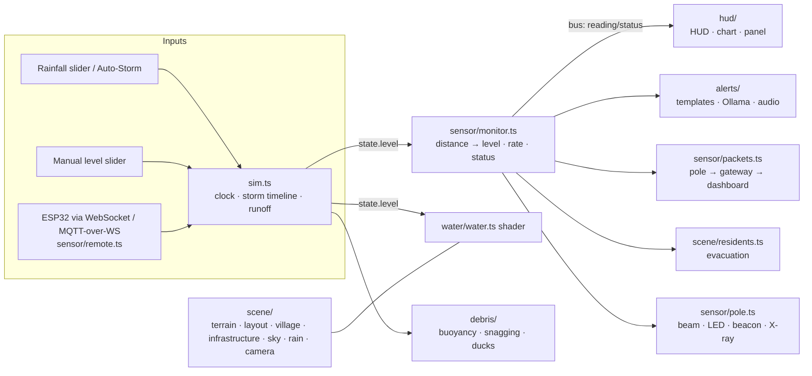

# Bantay Baha 🌊

**Bantay Baha** ("flood watch") is an interactive 3D flood-monitoring simulator of a Philippine barangay beside a creek. A solar-powered smart pole with an ESP32 and a waterproof ultrasonic sensor measures the distance to the water. That reading drives the flood you see, the HUD, multilingual advisories, sirens and evacuation.

Built with **Vite + TypeScript + Three.js**. Every model, texture and sound is procedural: no asset files, nothing paid or proprietary.

## Quick start

```bash
npm i && npm run dev
```

Open the URL Vite prints (default http://localhost:5173).

| Command | What it does |
| --- | --- |
| `npm run dev` | Dev server with hot reload |
| `npm run build` | Type-check + production build to `dist/` |
| `npm run preview` | Serve the production build |

### Docker

```bash
docker build -t bantay-baha .
```

```bash
docker run --rm -p 8080:80 bantay-baha
```

Then open http://localhost:8080.

## What's in the scene

- **Terrain:** riverbed, sloped banks, a concrete drainage canal, the main road, dirt lanes, and an arched bridge on two piers.
- **Barangay:** 23 homes (concrete, nipa on stilts, 2-storey) with warm lit windows at night. Also coconut and banana trees, bamboo fences, a basketball court, the barangay hall (evacuation center), and utility poles with sagging power lines.
- **Smart pole:** an ultrasonic transducer on an arm over the water with a visible translucent beam cone. It also carries the ESP32 enclosure, a solar panel, an antenna, a status LED and a warning beacon.
- **Sky:** day/night cycle (5 min), storm sky and fog, GPU rain, and lightning with thunder.
- **Water:** a custom shader with waves, foam where it meets banks and walls, and a colour shift from clear to muddy brown as it rises. The flood spreads over the banks, road and house floors as the level crosses terrain heights.
- **Debris:** logs, bottles, coconut fronds, tires, sacks, a monobloc chair and an occasional drifting bangka. They ride the waves, drift with the current, strand in shallows, and snag and pile up at the bridge until the water overtops the deck. More rain means more debris.
- **Residents:** they mill around their homes. As soon as WARNING is raised they **run** along the road and lanes to the barangay hall (preemptive evacuation), and walk home after a calm period.
- **Click-to-inspect hardware:** click the box on the sensor pole to open it, then click any part (ESP32, ultrasonic driver, battery pack, wiring, transducer, beam, solar panel, antenna, status LED, beacon, mast, gateway, dashboard) or its label. A card introduces the part with its specs and live readings, and a wire box outlines it.
- **Live ESP32 telemetry:** the HUD's *ESP32 telemetry* tab shows uptime, Wi-Fi RSSI, battery voltage and charge, solar input and net power, enclosure temperature, free heap, raw echo time, distance, packet count, and a scrolling log of the JSON payloads published over MQTT. The values are simulated from the scene (sun, rain, water); a live ESP32 overrides them.

## Controls

**Side panel** (⚙ toggles it; on phones it starts collapsed):

| Control | Effect |
| --- | --- |
| Rainfall | 0–100 mm/hr. Feeds the runoff model, rain density, debris count, lightning and water turbidity |
| Water level | Manual override (0.3–5.5 m). Switches the source to *Manual* |
| Auto-Storm ▶/⏸ | Plays a 90-minute typhoon rain band (rainfall rises, peaks and fades) |
| Speed | 1x–10x simulation speed (1x = 10 simulated seconds per real second) |
| Reset | Back to a calm creek |
| Debris / Rain / X-ray / Lola mode / Sound | Toggles |
| Language | English, Tagalog, Cebuano, Waray |
| Live ESP32 input | WebSocket or MQTT-over-WebSocket feed (see below) |
| Ollama | Use a local LLM to write advisories |

**Camera:** drag to orbit, right-drag to pan, scroll to zoom. The preset buttons are Overview, Sensor close-up, Street level, Bridge and 🎬 Cinematic fly-through. Any drag cancels a preset or fly-through.

**Easter eggs:**
- *Lola mode* delivers every advisory as a scolding grandmother, with a siren burst and a shake. Turn on Sound to hear it.
- ↑ ↑ ↓ ↓ ← → ← → B A launches the rubber duck armada.

## How the numbers work

- Gauge datum = riverbed. The transducer face is mounted **7.00 m** above it.
- `distance = 7.00 m − water level`. The HUD shows level, rise rate and raw distance, all **derived from the sensor distance**.
- The **single water-level value** (`state.level`) drives the water plane, beam length, debris buoyancy, wading, status and alerts.
- Status thresholds:

| Status | Level | Meaning in the scene |
| --- | --- | --- |
| NORMAL | < 200 cm | Creek inside its channel |
| ADVISORY | ≥ 200 cm | Approaching bank top |
| WARNING | ≥ 280 cm | Over the banks; preemptive evacuation, residents run to the hall |
| EVACUATE | ≥ 330 cm | Main road flooded |

- A rise of **≥ 30 cm per 10 min** escalates the status one step (flash-flood logic). Downgrades use hysteresis.
- *Rain model:* a linear reservoir, `dL/dt = 4e-5·rain − (L − 0.9)/900`.

## Architecture



```
src/
  main.ts            renderer, scene assembly, frame loop
  config.ts          world + hydrology constants, thresholds, layout anchors
  state.ts           global state + typed event bus
  sim.ts             sim clock, Auto-Storm timeline, rainfall→level model
  konami.ts          ↑↑↓↓←→←→BA listener
  util.ts            math, PRNG, geometry/texture helpers
  scene/             terrain, layout, village, infrastructure, geo, sky, rain, residents, cameraRig
  water/             water surface shader + CPU wave twin
  debris/            floating debris physics, rubber duck armada
  sensor/            smart pole, monitor (ESP32 logic), esp32 telemetry model, MQTT packet flow,
                     live input, component catalog + click-to-inspect
  hud/               HUD, chart, telemetry tab, control panel
  alerts/            4-language templates, Ollama client, WebAudio engine
```

Performance notes:
- Houses, windows, fences, trees and power poles are `InstancedMesh`.
- Rain is fully GPU-instanced (up to 14k streaks, zero per-frame CPU).
- Terrain depth for the water comes from a half-float height texture.
- Pixel ratio and shadow-map size drop on small screens.

## Live ESP32 input

Open **Live ESP32 input** in the panel, pick a protocol, enter the URL and press Connect.

- **WebSocket (JSON):** connect to any WebSocket server that relays your ESP32 messages.
- **MQTT over WebSocket:** a built-in minimal MQTT 3.1.1 client subscribes (QoS 0) to the topic you enter, e.g. Mosquitto with a `websockets` listener at `ws://broker:9001`.

Accepted payloads (distance from the transducer face to the water):

```
412
{"distance_cm": 412}
{"distance_m": 4.12}
{"level_cm": 288}
```

JSON payloads can also carry `rssi`, `batt_v`, `temp_c`, `heap_kb`, `solar_w` and `uptime_s`; the telemetry tab then switches from *SIMULATED* to *ESP32 LIVE* and shows your device's values.

Mount your sensor 7.00 m above your gauge zero, or send `level_cm` directly. Moving the manual level slider or playing the storm disconnects live input.

## Ollama (optional)

Enable **Ollama** in the panel. The default URL is `http://localhost:11434` and the default model is `llama3.2`. The app asks for a fresh advisory when the status, language or Lola mode changes. If the request fails or times out (8 s), the built-in templates are used and the alert box says so.

If the browser blocks the request (CORS), start Ollama with your dev origin allowed. In PowerShell:

```powershell
$env:OLLAMA_ORIGINS="http://localhost:5173"; ollama serve
```

## 1-minute demo script

1. **0:00 · Overview.** "This is a riverside barangay. That pole by the creek is our sensor: an ESP32 and an ultrasonic module, solar powered."
2. **0:08 · Sensor close-up**, then **click the box** and click the ESP32 board. "The enclosure opens up: ESP32, ultrasonic driver, two 18650 cells and the wiring. Each part explains itself, with live readings." Flip the HUD to **ESP32 telemetry** to show the payload log. The beam measures the distance down to the water. The blue dots are MQTT packets travelling to the gateway on the barangay hall and on to the dashboard."
3. **0:20.** Turn X-ray off, set **Speed 10x**, press **▶ Play storm**, click **Overview**. "A typhoon rain band arrives. Watch the rain, the rising level and the 10-minute chart."
4. **0:30.** The fast rise escalates the status to **WARNING**. Switch **Language** to Tagalog, then Cebuano. "Advisories are generated in four languages."
5. **0:38 · EVACUATE.** Click **Street level**. "The road floods, the siren sounds and the residents walk to the evacuation center." Then click **Bridge**. "Debris snags on the bridge and piles up."
6. **0:50.** Toggle **Lola mode** with Sound on. "Aba, apo, daghan na ang tubig! Dali, lakaw na!"
7. **0:55.** Click **🎬 Cinematic**. Bonus: type ↑↑↓↓←→←→BA for the duck armada.

## Notes

- The Tagalog, Cebuano and Waray templates were written for this demo. Have native speakers or your LGU's DRRM office review them before any real-world use.
- This is a visualization and training tool, not a certified early-warning system.

## License

[MIT](LICENSE)
