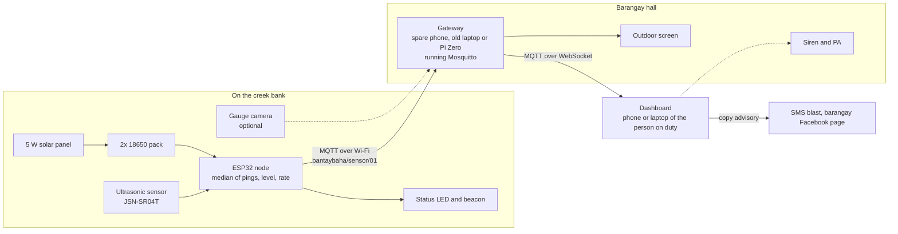
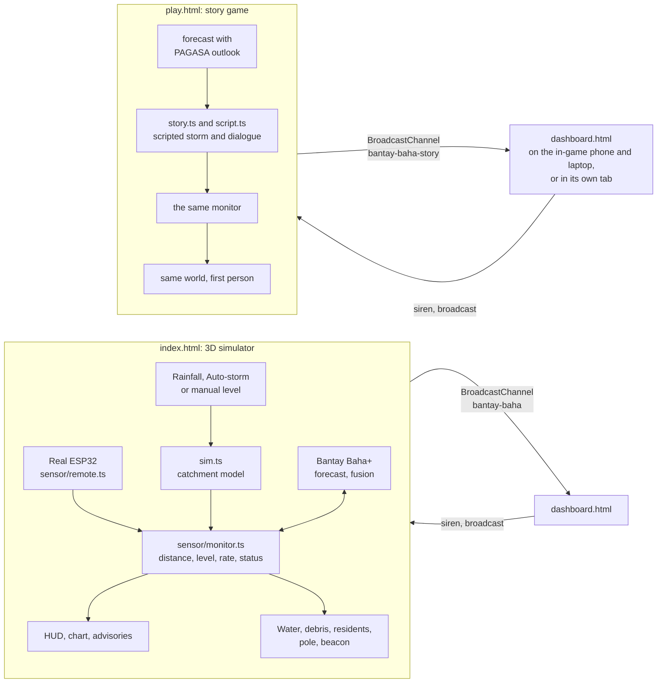

# System architecture

There are two ways to look at Bantay Baha:

- **The deployment:** a real sensor on a real creek, with a gateway and a dashboard.
- **The demo:** the same logic running in a browser against a simulated creek.

We built them to share as much code as possible. The alert rules, the forecast and the dashboard are the same files in both.

## The deployment



- **The sensor node** measures and does a first check on its own readings. It works out the level and the rise rate itself and sets its LED and beacon, so the pole still warns people walking along the creek if the gateway is down.
- **The gateway** is a Wi-Fi access point and a small computer running an MQTT broker. It lives at the barangay hall, which is also the evacuation center. Nothing in this path needs the internet.
- **The dashboard** is a static web page. It connects to the broker over MQTT-over-WebSocket, works out the status again from the raw distance (it doesn't simply trust the node), and keeps its own history on the device.
- The dotted siren line is not wired up in the live-device mode yet. It would need a command topic on the broker. In the simulator and the game, the dashboard's siren button does work.

### What the node sends

One JSON message every reading, on topic `bantaybaha/sensor/01`:

```json
{"id":"bb-01","seq":1532,"distance_cm":412.0,"level_cm":288.0,"rate_cm10":34.5,"status":"WARNING","batt_v":3.91,"rssi":-67,"temp_c":27.4}
```

The dashboard and the simulator also accept a bare number (distance in cm), `{"distance_cm": …}`, `{"distance_m": …}` or `{"level_cm": …}`. That way a first prototype can send the simplest thing that works and add fields later.

### How the alert level is decided

`src/sensor/status.ts` is the one place the rules live. The node's logic in the simulator and the dashboard both import it.

| Status | Level above gauge zero | What it means on this creek |
| --- | --- | --- |
| NORMAL | below 200 cm | Inside the channel |
| ADVISORY | 200 cm | Close to the bank top. Get ready |
| WARNING | 280 cm | Over the banks. Preemptive evacuation, siren |
| EVACUATE | 330 cm | Main road under water |

Two extra rules:

- **Rising fast:** 30 cm or more in 10 minutes moves the status up one level early.
- **Hysteresis:** to step back down, the level has to fall a margin below the threshold. Otherwise a creek sitting right at 280 cm would flip between ADVISORY and WARNING with every wave.

## The demo



The simulator and the game send the dashboard the same kind of readings a gateway would, over the browser's `BroadcastChannel` instead of MQTT. So the dashboard you see during the demo is the real one, not a mock-up. In the game, the phone and the laptop each show the dashboard in an iframe (`dashboard.html?embed=phone` and `?embed=laptop`). The siren and broadcast buttons on them act on the game world.

Messages between the pages (`src/net/protocol.ts`):

| From → to | Message | Carries |
| --- | --- | --- |
| Simulator or game → dashboard | `history` | The readings so far, when the dashboard first connects |
| Simulator or game → dashboard | `live` | One reading: level, distance, rate, status, node telemetry, rainfall, siren state, evacuation count, and the forecast if one is running |
| Dashboard → simulator or game | `hello` | "I just opened, send me the history" |
| Dashboard → simulator or game | `siren` | On or off |
| Dashboard → simulator or game | `broadcast` | The advisory text to play over the PA |

## Code layout

```
src/
  sim.ts, state.ts, config.ts   clock, catchment model, shared state and event bus, constants
  sensor/        node logic: monitor, status rules, ESP32 telemetry model, live input, the pole and gauge in 3D
  forecast/      Bantay Baha+ forecast: model loading and inference, ETA wording, HUD badge
  fusion/        Bantay Baha+ fusion: gauge camera, fusion and fault rules, fault injector, panel
  plus/          the on/off switches and the code that starts each add-on separately
  dashboard/     the operations dashboard page
  net/           MQTT-over-WebSocket client, simulator and dashboard protocol
  alerts/        advisories in four languages, optional Ollama, sirens and alarm sounds
  scene/, water/, debris/   the 3D barangay
  player/, game/            the first-person story game
  hud/           the simulator's HUD, panel and first-visit guide
tools/
  forecast/      Python: synthetic storms, features, training, evaluation
  voices/        exporting the script, recording the NPC lines with Chatterbox
```

### How the add-ons stay separate

The Bantay Baha+ features were added after the core worked, under one rule: don't break the core. Each lives in its own folder and is started from `src/plus/index.ts` inside its own `try`. Its switch is stored in the browser (`src/plus/flags.ts`). With both switches off, the simulator behaves exactly as it did before the add-ons existed. We checked that, because it's an easy promise to break by accident.
